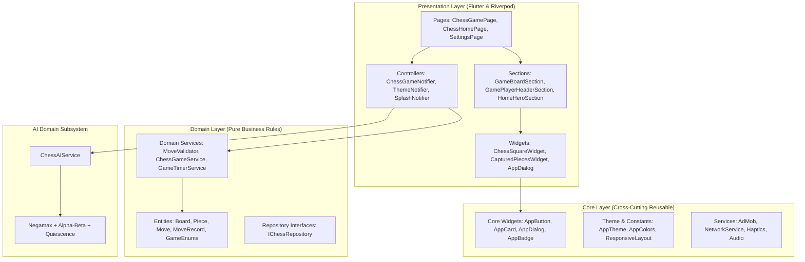
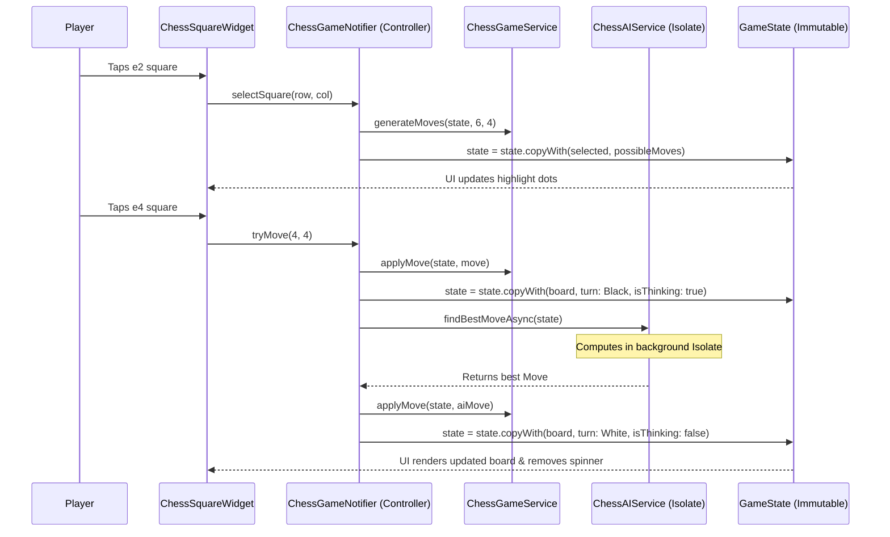

# Application Architecture & SOLID Principles

## 1. Clean Architecture Overview

Grandmaster Chess adheres to **Clean Architecture** with strict dependency boundaries pointing inward.

### Layer Responsibilities
1. **Presentation Layer (`lib/features/*/presentation/`)**:
   - Contains UI code organized into `pages/`, `sections/`, and `widgets/`.
   - **Mandatory Constraint**: Every widget and page is a pure `StatelessWidget` (or `ConsumerWidget`), with state and mutations delegated exclusively to controllers.
   - **Line Limit Rule**: Every single file is strictly under 200 lines.
2. **Domain Layer (`lib/features/*/domain/`)**:
   - Pure Dart code independent of Flutter UI libraries.
   - Contains immutable entities (`Board`, `Piece`, `Move`, `SquarePosition`, `MoveRecord`), enums, and pure business rule services (`MoveValidator`, `ChessGameService`, `GameTimerService`).
3. **Core Layer (`lib/core/`)**:
   - Shared cross-cutting components used by multiple feature modules.
   - Reusable stateless components (`AppButton`, `AppCard`, `AppDialog`, `AppBadge`, `ResponsiveLayout`, `GlowContainer`), design tokens (`AppColors`), theme configurations, and ad abstractions.

---

## 2. SOLID Principles in Action

### 2.1 S — Single Responsibility Principle (SRP)
*A class should have one, and only one, reason to change.*

- **Previous Anti-pattern**: `ChessGamePage` handled game lifecycle, timer ticks, move validation, game over dialogs, restart confirmation modals, and AdMob interstitial triggers all in a single massive 231-line `StatefulWidget`.
- **Clean Architecture Implementation**:
  - `ChessGamePage` (76 lines): Solely renders the page scaffold and delegates dialog events.
  - `GameCoordinator` (119 lines): Handles lifecycle side-effects (ads, alerts, promotions).
  - `ChessGameNotifier` (193 lines): Solely manages game state transitions and move execution.
  - `GameTimerService` (22 lines): Dedicated clock ticker.
  - `MoveValidator` (330 lines): Pure chess legality checks.

### 2.2 O — Open/Closed Principle (OCP)
*Software entities should be open for extension, but closed for modification.*

- The AI search architecture uses composable evaluators: `MaterialEvaluator`, `PstEvaluator`, `MobilityEvaluator`, and `KingSafetyEvaluator`.
- New positional factors (e.g., pawn structure evaluation, bishop pair bonus) can be added by implementing an evaluation component without altering the central `Negamax` search loop.

### 2.3 L — Liskov Substitution Principle (LSP)
*Subtypes must be substitutable for their base types.*

- All UI layouts implement clean interfaces or function builders. `ResponsiveLayout` swaps between `NarrowGameLayout` and `WideGameLayout` interchangeably based on screen geometry without affecting state handling or game logic.

### 2.4 I — Interface Segregation Principle (ISP)
*Clients should not be forced to depend on interfaces they do not use.*

- Rather than one colossal widget containing the entire chessboard and UI controls, the interface is split into fine-grained, focused widgets:
  - `ChessSquareWidget` (132 lines): Only cares about rendering 1 square and firing a tap.
  - `GameTimerWidget` (58 lines): Only cares about displaying time formatting.
  - `CapturedPiecesWidget` (53 lines): Only cares about rendering captured piece lists.

### 2.5 D — Dependency Inversion Principle (DIP)
*Depend on abstractions, not on concretions.*

- State is managed via Riverpod `Provider` and `StateNotifierProvider`.
- Presentation widgets do not instantiate dependencies directly via `new`; they read abstract providers injected through the Riverpod container graph (`ref.watch(chessGameProvider)`, `ref.read(homeActionsProvider)`).
- This makes unit testing trivial through `ProviderScope(overrides: [...])`.

---

## 3. State Management & Data Flow

---

## 4. UI Architecture Standards

1. **100% Stateless UI**:
   - Zero `StatefulWidget`, zero `State<T>`, zero `ConsumerStatefulWidget`.
   - All state is modeled in immutable state records and modified via Riverpod Notifiers.
2. **Strict File Size Budget**:
   - **All widgets and pages are under 200 lines**.
   - Modular decomposition: complex views are partitioned into clean, readable sections.
3. **Core Reusability**:
   - Any widget pattern repeated across 2 or more features lives in `lib/core/widgets/`.

